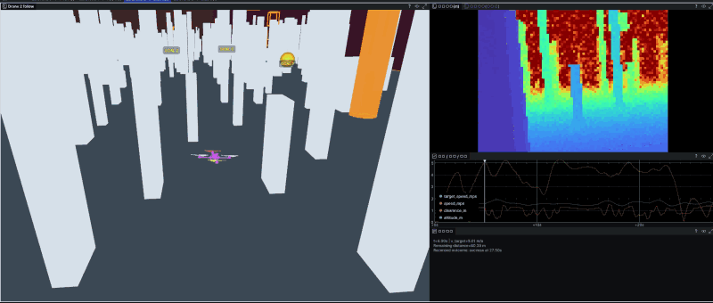

# Isaaclab-AerialNav-MBRL

An **Isaac Lab 3 extension** for quadrotor navigation using differentiable model-based reinforcement learning (MBRL). Training gradients propagate through a differentiable point-mass dynamics surrogate, enabling efficient policy optimization.
We further integrate **CUDA Graph optimizations** into the controller and parallel task computations, reducing GPU kernel-launch overhead and improving training throughput.
**Train a functional navigation policy in as little as 30 minutes on a single NVIDIA RTX 4090 GPU (0.5 GPU-hours).**

## Flight demos

[](docs/media/flight.mp4)


## Installation

Linux, an NVIDIA GPU, and Python 3.12 are required. From the repository root:

```bash
git clone https://github.com/sycamore-yu/Isaaclab-AerialNav-MBRL.git
cd Isaaclab-AerialNav-MBRL
uv sync --frozen --extra curobo
```

The environment pins Isaac Lab 3.0.0, Newton 1.6.1, and the tested cuRobo revision. See [installation](docs/installation.md) for GPU setup.

## Test the Policy

```bash
PYTHONPATH=src .venv/bin/python scripts/evaluate.py \
  --checkpoint weights/baseline_direct.pt \
  --stage finetune_s1 --episodes 1024 \
  --seed 10000 --terrain_seed 10000 \
  --output runs/evaluation.json
```

Results include success, collision, bounds, invalid state and timeout for every initial episode. Change both seeds to test another map.

## Train the Policy

```bash
PYTHONPATH=src .venv/bin/python scripts/train_diffnav.py \
  --log_dir runs/baseline --num_envs 512 \
  --stage finetune_s1 --fresh_stage \
  --seed 0 --terrain_seed 0
```

The default task has a 120 × 40 m world, 480 static and 32 dynamic obstacles, randomized dynamics, and target speeds of 1–6 m/s. 

GRU is the default. For optional [SRU-LSTM-Gated](https://github.com/leggedrobotics/sru-pytorch-spatial-learning) BPTT training, add `--recurrent_model sru_lstm_gated`; start from fresh weights rather than a GRU checkpoint.


## Acknowledgements

We would like to express our gratitude to the following projects and research works, which have provided significant support and inspiration for our work:

- [DiffAero](https://github.com/flyingbitac/diffaero) — A GPU-accelerated differentiable simulation framework for efficient quadrotor policy learning.
- [NavRL](https://github.com/Zhefan-Xu/NavRL) — Learning safe flight in dynamic environments using reinforcement learning.
- [Zhang et al. (2025)](https://doi.org/10.1038/s42256-025-01048-0) — Vision-based agile quadrotor flight through differentiable physics training.
- [Song et al.](https://proceedings.mlr.press/v270/song25a.html) — Differentiable policy learning with state alignment in non-differentiable physics simulation.

## PointNet point-cloud navigation

Use `scripts/train_diffnav.py presets=pointnet` for body-frame LiDAR XYZ and the
PointNet–GRU192 BPTT recipe on the existing navigation environment. No extra RL
environment is needed. See [usage and Rerun recording](docs/pointnet.md) and
[integration acceptance](docs/results/pointnet-preset-20261104.md).
