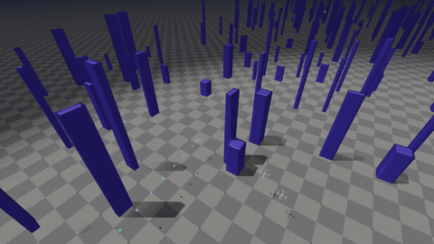
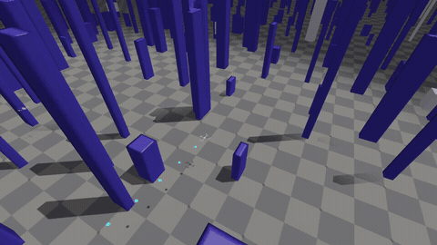

# AerialNav

Depth-based quadrotor navigation with differentiable training in Isaac Lab 3.

The baseline uses a CNN–GRU policy, Newton + Warp simulation, and SDF collision losses backed by cuRoboV2. Training gradients pass through a point-mass surrogate.

## Flight demos

[](docs/media/flight.mp4)

[Watch the full flight video (23.5 s)](docs/media/flight.mp4). The recording shows the 3D flight scene, depth observations, and flight telemetry.

### Additional static and dynamic examples

| Static obstacles | Moving obstacles |
| --- | --- |
| [](docs/media/static-flight.mp4) | [](docs/media/dynamic-flight.mp4) |
| [Full video · 1×](docs/media/static-flight.mp4) | [Full video · 1×](docs/media/dynamic-flight.mp4) |

Successful flights with the packaged GRU policy. Cyan marks the flown path; green marks the goal.

## Installation

Linux, an NVIDIA GPU, and Python 3.12 are required. From the repository root:

```bash
git clone https://github.com/sycamore-yu/Isaaclab-diff-aerialnav.git
cd Isaaclab-diff-aerialnav
uv sync --frozen --extra curobo
```

The environment pins Isaac Lab 3.0.0, Newton 1.6.1, and the tested cuRobo revision. See [installation](docs/installation.md) for GPU setup.

## Test the Policy

```bash
PYTHONPATH=src .venv/bin/python scripts/evaluate.py \
  --checkpoint weights/baseline_direct.pt \
  --stage finetune_s1 --episodes 1024 \
  --seed 10000 --terrain_seed 10000 \
  --output runs/evaluation.json
```

Results include success, collision, bounds, invalid state and timeout for every initial episode. Change both seeds to test another map.

## Train the Policy

```bash
PYTHONPATH=src .venv/bin/python scripts/train_diffnav.py \
  --log_dir runs/baseline --num_envs 512 \
  --stage finetune_s1 --fresh_stage \
  --seed 0 --terrain_seed 0
```

The default task has a 120 × 40 m world, 480 static and 32 dynamic obstacles, randomized dynamics, and target speeds of 1–6 m/s. Routes span `18 × target_speed` metres. Training uses 150-step BPTT, a 2-second velocity window, linear goal-speed guidance, and the original avoidance gradient.

Success requires ending within 0.5 m of the goal without failure. Arrival-triggered reset waits until more than 10 seconds after first entry and the drone is currently inside the goal region. Earlier failures and the episode time limit still end the episode.

For a short training check, add `--max_iterations 2`. See [training](docs/training.md) and [evaluation](docs/evaluation.md) for configuration and checkpoint export.

GRU is the default. For optional SRU-LSTM-Gated BPTT training, add `--recurrent_model sru_lstm_gated`; start from fresh weights rather than a GRU checkpoint.

## Acknowledgements

AerialNav uses [Isaac Lab](https://github.com/isaac-sim/IsaacLab) for simulation and [cuRobo](https://github.com/NVlabs/curobo) as an external collision-query dependency. Adapted code and assets from upstream projects are credited below:

- [Isaac Lab / ORBIT](https://github.com/isaac-sim/IsaacLab) — simulation integration and terrain helpers ([BSD-3-Clause](licenses/IsaacLab.txt)).
- [NavRL](https://github.com/Zhefan-Xu/NavRL) — navigation policy and PPO baseline adaptations ([MIT](licenses/NavRL.txt)).
- [OmniDrones](https://github.com/btx0424/OmniDrones) — rotor dynamics and the Hummingbird model ([MIT](licenses/OmniDrones.txt)).
- [SRU](https://github.com/leggedrobotics/sru-pytorch-spatial-learning) — optional SRU-LSTM-Gated cell ([MIT](licenses/SRU.txt)).

These components retain their original copyright notices and licenses, collected in [`licenses/`](licenses/).

## License

Original AerialNav code is licensed under [BSD-3-Clause](LICENSE). Third-party components retain their respective licenses, linked above.
