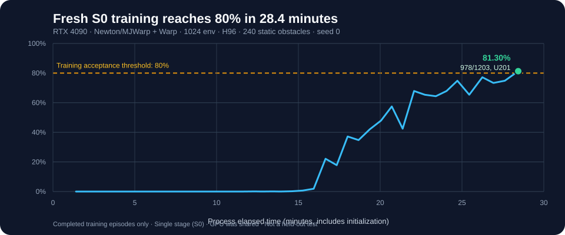

# Fresh S0 training evidence — 2026-11-02

A **freshly initialized** DiffNav CNN–GRU192 policy reached the **80% completed-episode training threshold** in the **first curriculum stage (S0)** at update **201**. The recorded process elapsed time was **28 min 26.1 s** on an NVIDIA RTX 4090, including initialization. The trainer's elapsed time was **27 min 36.9 s**. Neither value is a full five-stage training time or a held-out evaluation result.



## Verified result

| Item | Recorded value |
|---|---:|
| Task | `pretrain_s0`: 240 static / 0 dynamic, 120 × 40 m |
| Initialization | Random, seed 0, terrain seed 0, **no previous checkpoint** |
| Hardware | RTX 4090; other training jobs shared the GPU |
| Simulation | Newton/MJWarp solver, Warp frontend, cuRoboV2 SDF |
| Training | 1024 environments, 20 Hz, BPTT H96, CNN–GRU192 |
| Arrival rule | Within 0.5 m, first arrival + 5 s, final goal occupancy without failure |
| First training report ≥80% | **U201**; all 54 earlier report windows were below 80% |
| Final training report | **978 successes / 1203 completed episodes = 81.2968%** |
| Final report failures | 125 collisions, 19 bounds, 81 timeouts |
| Environment transitions | **19,759,104** (=201 × 1024 × 96) |
| Mean measured active update | **8.226 s** |
| Trainer elapsed | **1656.935 s = 27 min 36.9 s** |
| End-to-end process elapsed | **1706.117 s = 28 min 26.1 s** |
| Run status | `completed`, `stage_passed=true`, `five_stage_acceptance_passed=false` |
| Frozen source | [`9270b838a1fe`](https://github.com/sycamore-yu/Isaaclab-AerialNav-MBRL/commit/9270b838a1fed250a4e8cd2ee3fc027f49b13042) |

### Original invocation

The run used the repository's release training entrypoint; it stopped on the first successful completed-episode training report. Physics and frontend are explicit to avoid inheriting a different default.

```bash
PYTHONPATH=src .venv/bin/python scripts/train_diffnav.py \
  --log_dir runs/s0-fresh-20261102 --stage pretrain_s0 \
  --num_envs 1024 --report_episodes 1024 \
  --seed 0 --terrain_seed 0 --max_iterations 2000 \
  --stop_after_acceptance --timesteps 96 \
  --velocity_window_s 1.0 --coef_v 1.2 \
  --coef_collide 10.0 --coef_obj_avoidance 2.5 --grad_decay 0.4 \
  physics=newton_mjwarp --frontend warp
```

This reproduces the **configuration**, not a deterministic 28-minute runtime guarantee; simulator/GPU contention and hardware environment affect timing.

### Published data and verification

- [`training-windows.csv`](training-windows.csv): 55 original completed-episode report windows, with corresponding process and trainer times. Each `success_rate` is successes / completed episodes for **that** window, not a moving average or independent evaluation.
- [`update-timing.csv`](update-timing.csv): all 201 update durations, cumulative elapsed times, environment steps, and H value.
- [`receipt.json`](receipt.json): complete protocol, result summary, source commit, and SHA-256 hashes of the **original local logs and final checkpoint**. Machine-local paths are deliberately omitted from public data.
- [`verify_receipt.py`](verify_receipt.py): standard-library verification of CSV counts, threshold crossing, elapsed times and environment transitions.

The original, unchanged local files are stored in this experimental run's `fresh_s0/train/` directory on the training machine; their SHA-256 hashes appear in `receipt.json`. The public CSV data are selected columns extracted from these records and can be recomputed from the originals. The full checkpoint and raw training logs are **not** uploaded as part of this report.

### Scope and interpretation

The result demonstrates **time to the first 80% on-training S0 reporting window**. It does **not** establish 80% success on an independently seeded held-out map, long-window stability, dynamic-obstacle navigation, completion of S1/S2/F1/F2, or a 0.5 *exclusive* GPU-hour computation budget. The single RTX 4090 concurrently ran other experiments; there is no uncontended GPU timing baseline for this training run.

To continue the five-stage curriculum, begin `pretrain_s1` with the saved S0 checkpoint via `--checkpoint` (stage transfer), **not** `--resume_checkpoint` (same-stage continuation). The S0 command above did not launch subsequent stages automatically.
